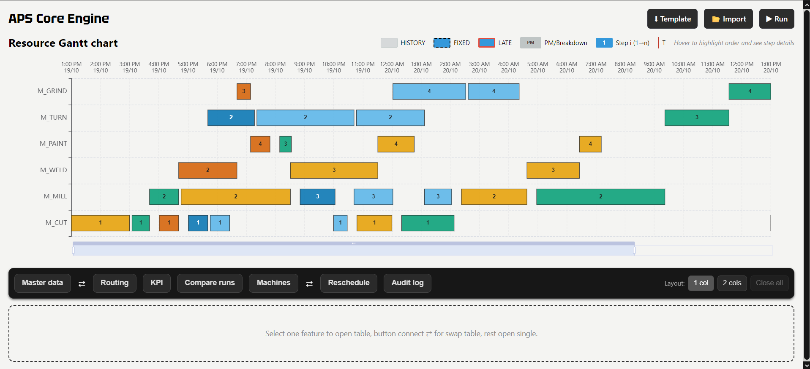
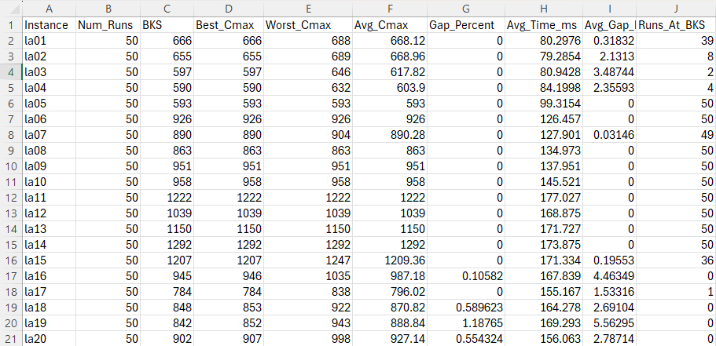
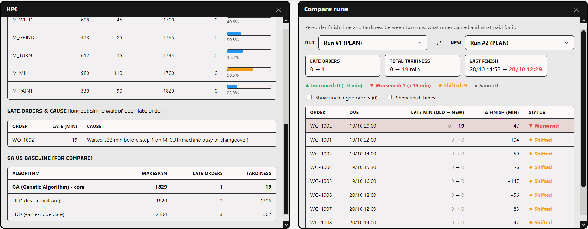
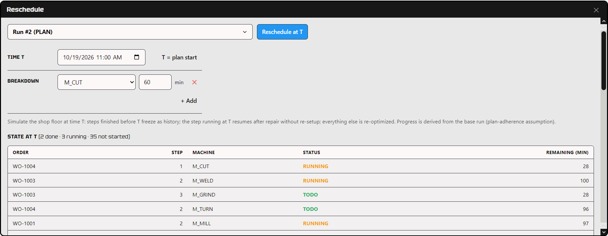
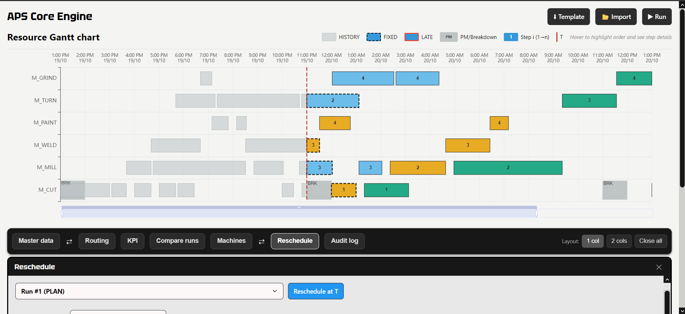

# mes-aps: Advanced Planning & Scheduling for a Job Shop



**Live demo:** https://mes-aps-rosy.vercel.app/ · **API:** https://mes-aps.onrender.com · **Docs:** [System Metrics & Business Logic](./docs/BUSINESS_LOGIC.md)

## Overview

mes-aps plans a factory floor the way a production planner needs it: import orders, run the optimizer, read a Gantt chart and a KPI panel, then re-plan when a machine breaks.

It extends the classic Job Shop Scheduling Problem (JSSP) with real MES constraints: release and due dates, order priorities, product-family setup (changeover) times, machine efficiency, planned maintenance, breakdowns and rescheduling from a chosen time **T**. The optimizer is a **C++ Genetic Algorithm** with a greedy construction step, exposed to a **Node.js** backend through **N-API**, with a **React** front end.

## Key Features

* **Interactive Gantt chart:** one row per machine. Hover a step to highlight every step of the same order. Gray blocks are history, dashed outlines are fixed (running) steps, red outlines are late orders, and the red dashed line marks time T.
* **KPI panel:** makespan, end time, late orders, OTD, total tardiness, setup ratio, bottleneck, utilization per machine and the cause of each delay.
* **Master data:** import orders from CSV/Excel (validated), edit quantity, priority, release and due date, export to Excel.
* **Machines:** set efficiency per machine and add planned maintenance or breakdown windows.
* **Reschedule at time T:** steps finished before T are frozen, the step running at T resumes with its remaining time after a repair, and everything else is re-optimized.
* **Compare runs:** per-order finish time, tardiness and status (improved, worsened, shifted) between any two runs.
* **GA vs FIFO / EDD:** every run is benchmarked against two classic dispatching rules.
* **Audit log:** every action (import, update, run, reschedule) is recorded and filterable.

## How It Works

<pre align="center">
React (Vercel)  ──REST──▶  Node.js API (Render)  ──N-API worker──▶  C++ GA engine
                                   │
                                   ▼
                       PostgreSQL (Supabase)
</pre>

* The C++ engine runs in a worker so a long optimization never blocks the Node.js event loop.
* Routing and setup data use cache-friendly flat arrays (`opMatrix`, `setupLookup`).
  Measured on the 12-order workshop dataset (GA 100 x 3000): ~0.55 s per run on a local laptop CPU and ~4.4 s on Render's shared free-tier CPU for the same input.
  The timed section is the C++ worker alone; the gap is hardware, not code, and the hosted demo shows a loading skeleton while it runs.
* The GA minimizes one score:

  ```
  Fitness = Makespan + Σ (Tardiness × PriorityWeight) + TotalSetupTime
  PriorityWeight: Normal = 10, High = 50, Urgent = 200
  ```

  Late urgent orders cost far more than a slightly longer plan, so the optimizer protects them first.
* Machines run continuously (three shifts), so the model has no shift calendar.

See [BUSINESS_LOGIC.md](./docs/BUSINESS_LOGIC.md) for every formula with worked examples.

## Results

Data for this result can see form: [data.js](frontend/src/utils/data.js)

| Scenario | Algorithm | Makespan (min) | Late orders | Total tardiness (min) |
| :--- | :--- | ---: | ---: | ---: |
| Congested, 10 orders, 6 machines | **GA** | 1792 | **0** | **0** |
| | FIFO | 1792 | 3 | 1331 |
| | EDD | 2235 | 2 | 262 |

The GA's advantage appears under congestion (urgent orders arriving into a busy shop). With light load every method reaches the same makespan, because the makespan cannot fall below the release time plus the processing time of the last order.

<p align="center">
  
</p>
<p align="center"><em>Benchmark results.</em></p>


## Screenshots main UI

| Compare Scenarios (What-If) | Reschedule & Breakdown |
| :---: | :---: |
|  |  |
| *Compare runs to see shifted minutes, late status and KPIs.* | *Handle machine downtime at a specific time T.* |

<p align="center">
  
</p>
<p align="center"><em>Gantt chart after rescheduling.</em></p>

## Testing

Ten black-box scenarios were run against the full stack.

<details>
<summary>View all 10 test scenarios</summary>

| ID | Scenario | Result |
| :--- | :--- | :---: |
| TC001 | Import validation (priority must be 1–3), template round-trip, master data export | Pass |
| TC002 | Run schedule: loading skeleton, Gantt render, hover highlight, step labels when zoomed | Pass |
| TC003 | Change quantity, routing snapshot refresh, audit log entries | Pass |
| TC004 | Due date earlier than release: order flagged late, KPI and delay cause updated | Pass |
| TC005 | Maintenance window and efficiency change: plan-outdated hint, grey block, cutting time doubles | Pass |
| TC006 | Reschedule at T with a breakdown: T line, resumed step with remaining time | Pass |
| TC007 | Compare two runs and swap them: improved ↔ worsened | Pass |
| TC008 | Audit log action filter | Pass |
| TC009 | CSV export row count equals Gantt block count | Pass |
| TC010 | Downtime validation (end after start), layout controls | Pass |

</details>

## ⚠️ Limitations & Roadmap

* **One machine per operation (JSSP, not FJSSP).** If a machine breaks, its steps wait for repair instead of moving to an alternative machine. Flexible job shop scheduling is the next step.
* **The GA has no local search.** It is a plain GA (operation-based encoding + POX +
  swap mutation + elitism), *not* a memetic/hybrid GA. On the Lawrence benchmarks it
  reaches best-known solutions on 16/20 of la01-la20 (best of 50 seeded runs) but keeps
  0.1-1.2% gaps on the 10x10 instances (la16-la20), where critical-path local search
  would close them. First roadmap item.
* **Baselines are order-block dispatchers.** FIFO/EDD here sequence whole orders
  block-wise, weaker than queue-based dispatching in real shops: an honest lower bar,
  not a strawman-free comparison.
* The model assumes continuous operation, with no shift calendar or operator constraints.
* Planned: a bulk endpoint for saving machine efficiency, order status in the CSV export, a machine-load-over-time view.


## Getting Started

<details>
<summary>View installation instructions</summary>

### Prerequisites

- Node.js and npm
- PostgreSQL 14+
- C++ compiler supporting C++17 or later
- Python 3.x for node-gyp

### 1. Build the C++ Engine

```bash
cd aps-engine
npm install
npm run build
```

### 2. Backend Setup

```bash
cp backend/.env.example backend/.env
npm install
```

Create the `mes_aps` database in PostgreSQL, then run:

```bash
psql -U postgres -d mes_aps -f docs/db/001_core.sql
psql -U postgres -d mes_aps -f docs/db/002_seed_workshop.sql
```

Start the backend:

```bash
npm run dev -w backend
```

Backend health check: `http://localhost:3000/healthz`

### 3. Frontend Setup

```bash
cp frontend/.env.example frontend/.env
```

Set `VITE_API_BASE=http://localhost:3000/api` in `frontend/.env`, then run:

```bash
npm run dev -w frontend
```

Build for production:

```bash
npm run build -w frontend
```

</details>

## ☁️ Deployment

| Piece | Host | Notes |
| :--- | :--- | :--- |
| Frontend | Vercel | `VITE_API_BASE` baked at build time |
| Backend | Render | build `npm install && npm run build -w aps-engine`; start `npm run start -w backend`; health check `/healthz` |
| Database | Supabase (Singapore) | direct connection only: the session GUC `TimeZone` does not survive the transaction pooler |

---
<div align="center">
  <p><i>- algernon -</i></p>
</div>